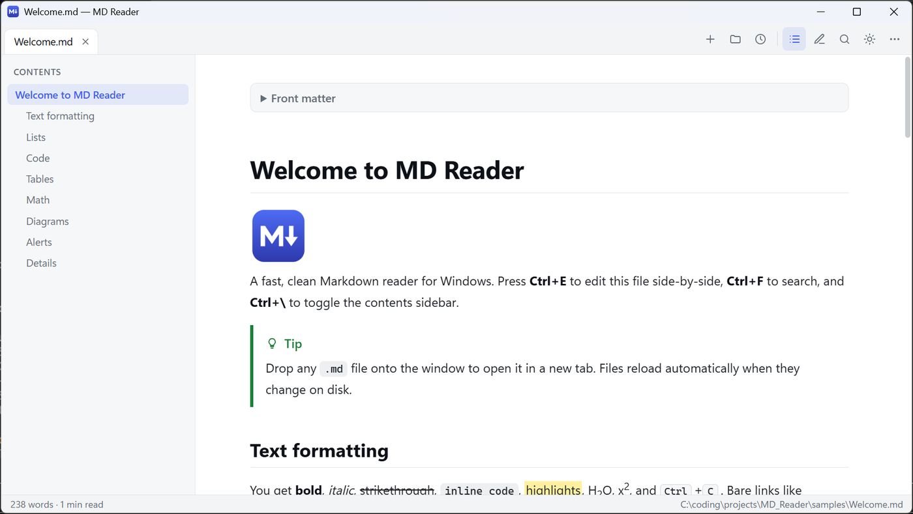

# MD Reader

A fast, clean Markdown reader for Windows with a quick side-by-side editor. It's a single 6 MB `.exe` that works offline.

**[Download](https://github.com/Himmatilloxon/md-reader/releases/latest/download/MDReader-win-x64.zip)** · **[Website](https://himmatilloxon.github.io/md-reader/)** · [All releases](https://github.com/Himmatilloxon/md-reader/releases)



## Features

- **Reading:** GitHub-style rendering, light and dark themes (follows Windows by default), zoom, print or save as PDF, and export to HTML.
- **Tabs:** open many files at once, drag tabs to reorder, and reopen closed tabs. Open tabs come back when you restart.
- **Recent files:** shown on the start screen and under the clock button.
- **Contents sidebar:** a clickable outline that highlights where you are in the document.
- **Code:** syntax highlighting for about 190 languages, with a copy button on each code block.
- **Math and diagrams:** KaTeX for `$inline$`, `$$display$$` and ` ```math ` blocks. Mermaid for ` ```mermaid ` diagrams.
- **GitHub extras:** tables, task lists, footnotes, alerts (`> [!NOTE]`, `[!TIP]`, `[!WARNING]`…), `<details>` blocks, and front matter.
- **Find:** Ctrl+F searches the rendered page, or the source text when the editor has focus.
- **Quick edit:** Ctrl+E opens a split editor with a live preview and synced scrolling. Lists continue when you press Enter, and Ctrl+B, Ctrl+I and Ctrl+K add bold, italic and links.
- **Live reload:** files reload when another program changes them. If you also have unsaved edits, it asks which version to keep.
- **Links:** links to other `.md` files open in a new tab, including `#anchor` jumps. Relative images load from disk.
- **Single instance:** double-clicking another `.md` file opens it as a tab in the window you already have open.
- **Safety:** HTML in documents is sanitized, so scripts never run. Links to programs or scripts only show the file in Explorer.

## Install

1. Download **[MDReader-win-x64.zip](https://github.com/Himmatilloxon/md-reader/releases/latest/download/MDReader-win-x64.zip)** and extract it.
2. Double-click **`install.cmd`**. It installs for your user only, so you don't need admin rights. If SmartScreen says "Windows protected your PC", click **More info → Run anyway**, because the app isn't code-signed.

Prefer a portable app? Download [`MDReader.exe`](https://github.com/Himmatilloxon/md-reader/releases/latest/download/MDReader.exe) and run it from anywhere.

### Build from source

```powershell
.\build.ps1      # builds dist\MDReader.exe (needs the .NET 8 SDK)
.\install.ps1    # per-user install: Start menu entry + "Open with" for .md files
```

Windows won't let an app make itself the default program. After installing, set it yourself: right-click any `.md` file, choose **Open with › Choose another app › MD Reader**, and tick **Always**. You can also do this in **Settings › Apps › Default apps › MD Reader**.

To uninstall, use **Settings › Apps** or run `uninstall.cmd`. Add `-Purge` to also delete settings.

**Requirements:** Windows 10/11 with the .NET 8 Desktop Runtime and the Edge WebView2 Runtime. Windows 11 already includes WebView2.

## Shortcuts

| Keys | Action |
|---|---|
| Ctrl+O / Ctrl+N | Open / new file |
| Ctrl+S / Ctrl+Shift+S | Save / save as |
| Ctrl+W, Ctrl+Shift+T | Close tab, reopen closed tab |
| Ctrl+Tab, Ctrl+1…9 | Switch tabs |
| Ctrl+E | Toggle editor |
| Ctrl+\\ | Toggle contents sidebar |
| Ctrl+F, F3, Shift+F3 | Find, next, previous |
| Ctrl+R | Reload from disk |
| Ctrl+P | Print / save as PDF |
| Ctrl+= / Ctrl+- / Ctrl+0, Ctrl+wheel | Zoom |

## How it's built

- `src/MDReader`: a WPF host (C#, .NET 8) around Edge WebView2. The host handles windows, file dialogs, saving with the original encoding and line endings kept, file watching, single instance (named pipe), recent files and session, and dark title bars.
- `src/MDReader/wwwroot`: the UI (plain JS). It uses markdown-it, DOMPurify, highlight.js, KaTeX, Mermaid and CodeMirror 5. Library versions are pinned in `tools/fetch-vendor.ps1` and embedded in the exe.
- Settings are stored in `%APPDATA%\MDReader\settings.json`.

## Releasing a new version

Push a tag and GitHub Actions will build and publish the release:

```powershell
git tag v1.1.0
git push origin v1.1.0
```

## License

[MIT](LICENSE). Bundled libraries are listed in [THIRD_PARTY_NOTICES.md](THIRD_PARTY_NOTICES.md).
