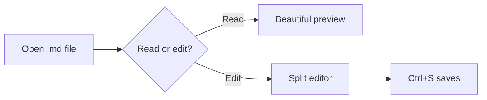

# Welcome to MD Reader


A fast, clean Markdown reader for Windows. Press **Ctrl+E** to edit this file side-by-side, **Ctrl+F** to search, and **Ctrl+\\** to toggle the contents sidebar.

> [!TIP]
> Drop any `.md` file onto the window to open it in a new tab. Files reload automatically when they change on disk.

## Text formatting

You get **bold**, *italic*, ~~strikethrough~~, `inline code`, <mark>highlights</mark>, H<sub>2</sub>O, x<sup>2</sup>, and <kbd>Ctrl</kbd>+<kbd>C</kbd>. Bare links like https://example.com turn into links automatically. Footnotes work too.[^1]

[^1]: Like this one. Click the number to jump back.

## Lists

- [x] Tabs and recent files
- [x] Table of contents
- [ ] Take over the world
  - Nested item
  - Another one

1. First
2. Second
3. Third

## Code

```python
def fib(n: int) -> int:
    """Return the n-th Fibonacci number."""
    a, b = 0, 1
    for _ in range(n):
        a, b = b, a + b
    return a
```

```csharp
var reader = new MarkdownReader();
await reader.OpenAsync("README.md");
```

## Tables

| Feature        | Status | Notes                          |
|:---------------|:------:|-------------------------------:|
| Syntax colors  | ✅     | 190+ languages                 |
| Math           | ✅     | KaTeX                          |
| Diagrams       | ✅     | Mermaid                        |

## Math

Inline math like $e^{i\pi} + 1 = 0$ and display math:

$$
\int_{-\infty}^{\infty} e^{-x^2}\,dx = \sqrt{\pi}
$$

## Diagrams



## Alerts

> [!NOTE]
> Useful information that users should know.

> [!WARNING]
> Critical content demanding attention.

> [!CAUTION]
> Negative potential consequences of an action.

## Details

<details>
<summary>Click to expand</summary>

Hidden content, with **Markdown** inside.

</details>

---

Links to [other files](Second.md#second-heading) open in a new tab.
